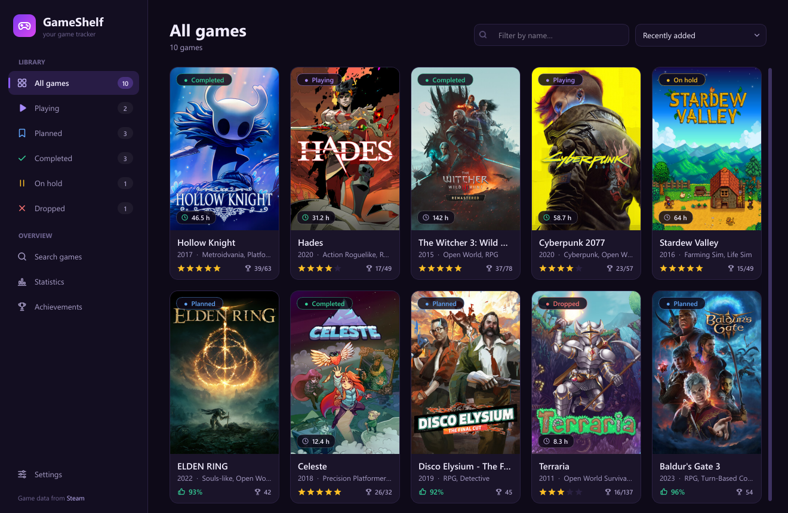
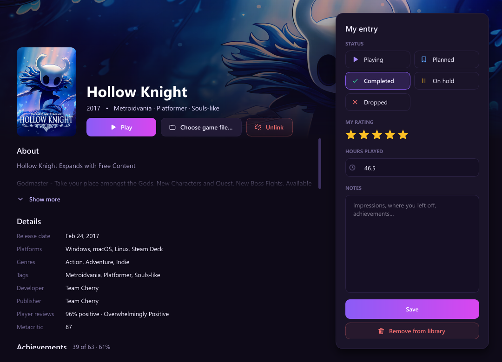
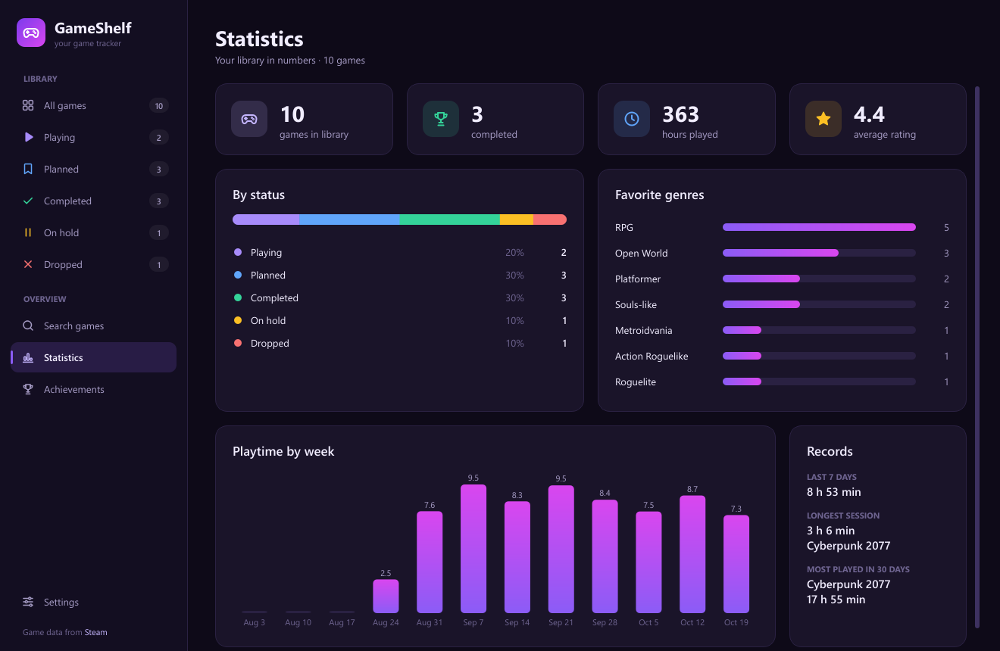
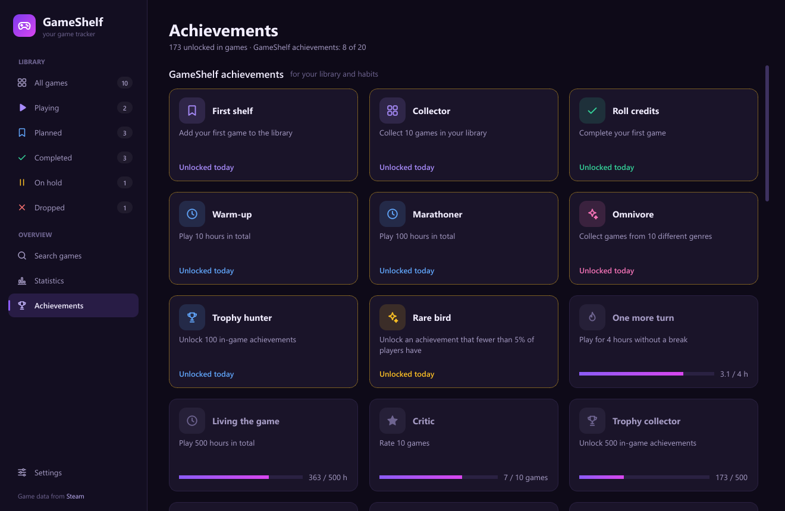
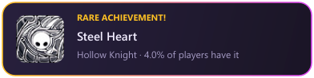

# GameShelf

**A free desktop game tracker for Windows.** Keep your library in one place, see how long you really play, and get
achievement popups right over your games, from Steam games and emulator builds alike.

[Русская версия →](README.ru.md)



## Features

- **Library with statuses:** Playing, Planned, Completed, On hold, Dropped, plus a rating, hours and notes for each game.
- **Search the Steam catalog** with no account or API key. Covers, descriptions, genres and player reviews are loaded
  for you. The RAWG catalog, which also has console games, is optional.
- **Automatic playtime tracking.** Games from Steam, Epic Games and GOG are found on your PC automatically. For any other
  game, choose its `.exe` or just drag the file or its shortcut into the game window.
- **Statistics:** hours by week, your longest session, the game you played most this month, favorite genres.
- **Achievements:** from Steam and from builds that use Steam emulators (Goldberg/GSE, CODEX, RUNE, OnlineFix,
  CreamAPI and others), with real names, icons and rarity.
- **In-game overlay:** a new achievement pops up in the corner of the screen right over the game.
- **20 GameShelf achievements** for your library and habits: *Finisher*, *Marathoner*, *One more turn*…
- Runs quietly in the system tray and can start with Windows so playtime is always tracked.
- **English and Russian** interface: it follows your Windows language by default and can be changed in Settings.

| Game window | Statistics |
|---|---|
|  |  |
| **Achievements** | **Overlay popup** |
|  |  |

## Download

1. Open the [latest release](../../releases/latest) and download `GameShelf-<version>-windows.zip`.
2. Unzip it anywhere, for example to `C:\Games\GameShelf`.
3. Run `GameShelf.exe`. No installer, no Python, no account needed.

Keep `GameShelf.exe` next to its `_internal` folder. Windows SmartScreen may warn you because the app isn't code-signed:
click **More info → Run anyway**.

Requires Windows 10 or 11 (64-bit).

## How it works

**Playtime.** GameShelf looks at the list of running processes once in a while, just like Task Manager does, and counts
the time while a game from your library is running. It never injects anything into games. Optionally, only time while
the game window is active is counted. Closing the window minimizes GameShelf to the tray icon so tracking continues.
You can also import your past hours from Steam once (*Settings → Import hours from Steam*).

**Achievements.** Steam achievements are read from Steam's own files on your disk. For emulator builds, GameShelf
finds the game's Steam app ID from the files next to the `.exe` and reads which achievements are unlocked. Names, icons
and rarity come from Steam. Steam writes progress to disk when it exits, so the very latest unlocks may show up with a
delay.

**Overlay.** The popup is a separate transparent window: it doesn't take focus from the game, clicks go through it, and
nothing is injected into the game, so anti-cheat has nothing to notice. It works in windowed and borderless fullscreen
modes. In old *exclusive* fullscreen, Windows doesn't allow drawing over the game, so the popup appears when you leave
it. Popups for achievements unlocked by Steam itself are off by default, because Steam has its own overlay.

## Privacy

Your library stays on your computer, in `%APPDATA%\GameShelf`:

- `library.db` is your library (SQLite);
- `settings.json` holds your settings (and the RAWG key, if you added one);
- `covers/` and `achievements/` hold cached images and data.

GameShelf has no servers, no accounts and no telemetry. It only connects to the Steam store and Steam's public APIs
for game info, covers and achievement data, and to RAWG if you choose that catalog.

## Run from source

You need Python 3.12+ on Windows.

```bash
python -m venv .venv
.venv\Scripts\python -m pip install -r requirements.txt
.venv\Scripts\python main.py
```

Or just double-click `run.bat`. It creates the environment on first run.

**Build the exe:** double-click `build.bat`, or run `python build.py`. It uses PyInstaller and puts the app in
`dist\GameShelf` (about 65 MB). `python build.py --shortcut` also creates a desktop shortcut.

## Project structure

```
main.py                    entry point (chooses the interface language first)
build.py, build.bat        exe build (PyInstaller)
gameshelf/
  app.py                   application and services startup, restart after a language change
  i18n.py                  interface language: tr() / ntr()
  locales/en.py            English translation (Russian source text → English)
  config.py                paths and settings
  models.py                Game, statuses
  database.py              SQLite storage, Library with a changed signal
  providers/               game catalogs: Steam (no key), RAWG (key)
  tracking/                running processes, installed games (Steam / Epic / GOG), linking, playtime tracker
  achievements/            Steam local files, emulator builds, Steam Web API, GameShelf achievements
  ui/                      main window, pages, game window, settings, overlay, intro, widgets
```

## Translations

Russian is the source language in the code, and English comes from `gameshelf/locales/en.py`, where every Russian
string maps to its English text. Corrections are welcome: open an issue or a pull request.

## Credits

Made by **Disorder Game Studio**.

Game data is provided by [Steam](https://store.steampowered.com) and [RAWG](https://rawg.io). GameShelf isn't
affiliated with Valve, Epic Games, GOG or RAWG. Steam is a trademark of Valve Corporation.

## License

[MIT](LICENSE) © 2026 Disorder Game Studio.

The Windows build includes [Qt for Python (PySide6)](https://doc.qt.io/qtforpython/), which is licensed under the
LGPLv3. Its libraries ship as separate files in the `_internal` folder.
