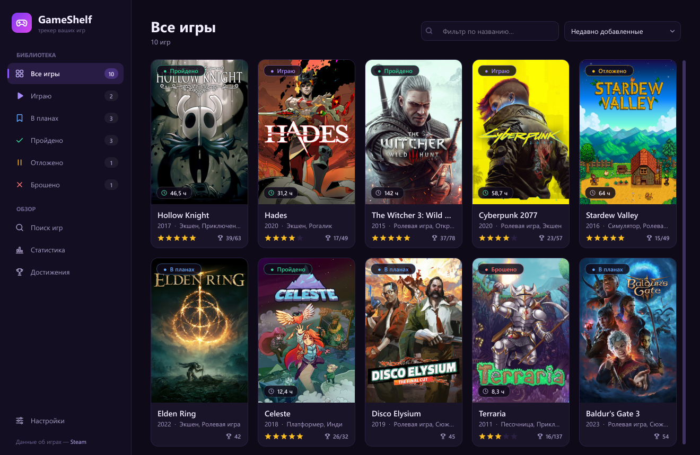
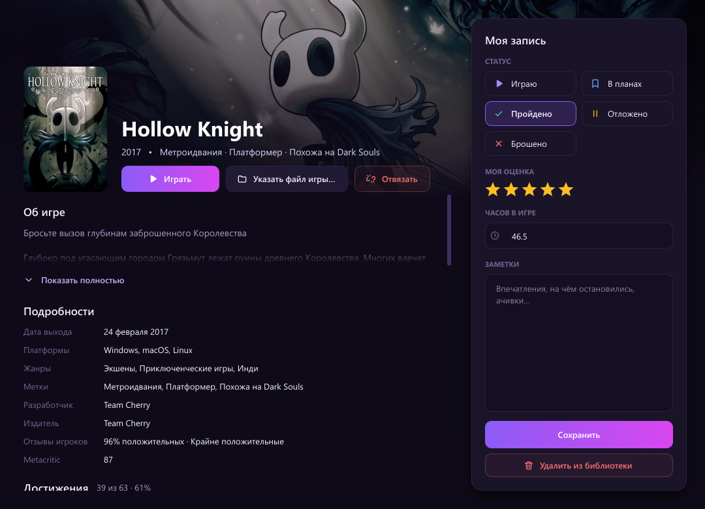
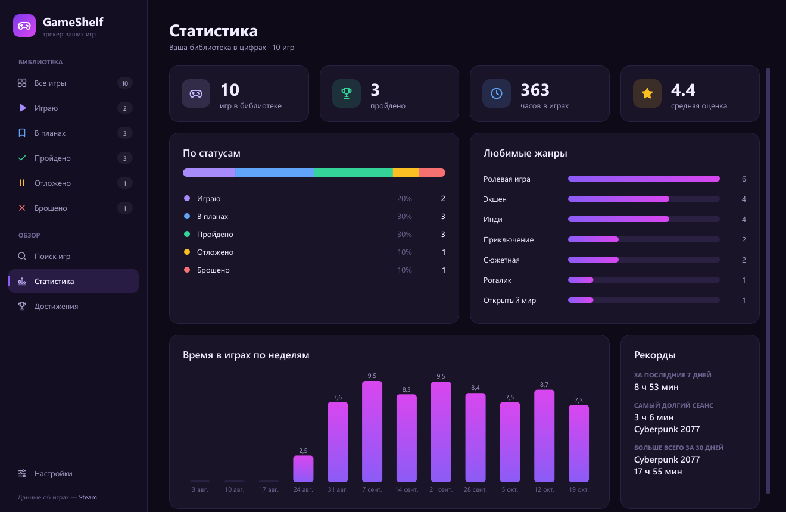
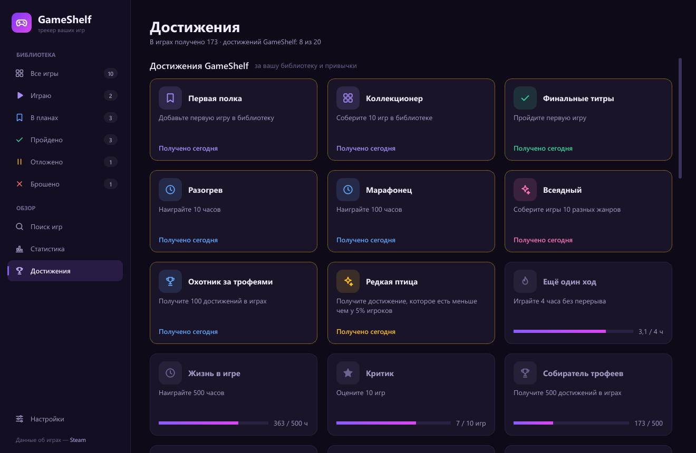

# GameShelf

**Бесплатный трекер игр для Windows.** Вся библиотека в одном месте, честный учёт времени в играх и плашки
о достижениях прямо поверх игры — и для Steam, и для сборок с эмуляторами Steam.

[English version →](README.md)



## Возможности

- **Библиотека со статусами** «Играю», «В планах», «Пройдено», «Отложено», «Брошено»; оценка, часы и заметки к каждой игре.
- **Поиск по каталогу Steam** без регистрации и ключей: обложки, описания на русском, жанры, отзывы игроков.
  По желанию — каталог RAWG (там есть и консольные игры).
- **Учёт времени сам по себе.** Игры из Steam, Epic Games и GOG находятся на компьютере автоматически; для любой другой
  игры укажите её `.exe` или просто перетащите файл либо ярлык в окно игры.
- **Статистика:** часы по неделям, самый долгий сеанс, игра месяца, любимые жанры.
- **Достижения** из Steam и из сборок с эмуляторами Steam (Goldberg/GSE, CODEX, RUNE, OnlineFix, CreamAPI и др.) —
  с настоящими названиями, иконками и редкостью.
- **Оверлей в игре:** новое достижение всплывает плашкой в углу экрана прямо поверх игры.
- **20 своих достижений GameShelf** за библиотеку и привычки: «Финишер», «Марафонец», «Ещё один ход»…
- Тихо работает в значке у часов и может запускаться вместе с Windows, чтобы время считалось всегда.
- **Русский и английский** интерфейс: по умолчанию — как в Windows, меняется в настройках.

| Окно игры | Статистика |
|---|---|
|  |  |
| **Достижения** | **Плашка оверлея** |
|  |  |

## Скачать

1. Откройте [последний выпуск](../../releases/latest) и скачайте `GameShelf-<версия>-windows.zip`.
2. Распакуйте куда угодно, например в `C:\Games\GameShelf`.
3. Запустите `GameShelf.exe`. Установка, Python и регистрация не нужны.

`GameShelf.exe` должен лежать рядом с папкой `_internal`. Windows SmartScreen может предупредить, что программа
без цифровой подписи, — нажмите **«Подробнее» → «Выполнить в любом случае»**.

Нужна Windows 10 или 11 (64-битная).

## Как это устроено

**Время в играх.** GameShelf время от времени смотрит список запущенных процессов — как Диспетчер задач — и считает
время, пока запущена игра из библиотеки. В сами игры он не вмешивается. Можно считать только время, когда окно игры
активно. При закрытии окна программа сворачивается в значок у часов, и учёт продолжается. Прошлые часы можно один раз
перенести из Steam («Настройки → Перенести часы из Steam»).

**Достижения.** Достижения Steam читаются из файлов Steam на диске. У сборок с эмуляторами GameShelf находит номер игры
в Steam по файлам рядом с `.exe` и читает, какие достижения получены; названия, иконки и редкость подтягиваются из Steam.
Steam записывает прогресс на диск при выходе из Steam, поэтому самое свежее иногда появляется с задержкой.

**Оверлей.** Плашка — отдельное прозрачное окно: фокус у игры она не забирает, клики проходят сквозь неё, в игру
ничего не внедряется (античитам нечего замечать). Видна в оконном режиме и в режиме «полноэкранный без рамки». В старом
*эксклюзивном* полноэкранном режиме Windows не даёт рисовать поверх игры — плашка появится, когда вы из него выйдете.
Для достижений, которые засчитал сам Steam, плашка по умолчанию выключена: у Steam есть свой оверлей.

## Данные и приватность

Библиотека хранится только на вашем компьютере, в `%APPDATA%\GameShelf`:

- `library.db` — библиотека (SQLite);
- `settings.json` — настройки (и ключ RAWG, если вы его добавили);
- `covers/` и `achievements/` — кэш картинок и данных.

У GameShelf нет серверов, аккаунтов и телеметрии. Программа обращается только к магазину Steam и открытым API Steam
(сведения об играх, обложки, достижения) и к RAWG, если выбран этот каталог.

## Запуск из исходников

Нужен Python 3.12+ под Windows.

```bash
python -m venv .venv
.venv\Scripts\python -m pip install -r requirements.txt
.venv\Scripts\python main.py
```

Или дважды щёлкните `run.bat` — при первом запуске он сам создаст окружение.

**Сборка exe:** `build.bat` или `python build.py` (PyInstaller) — программа появится в `dist\GameShelf` (около 65 МБ).
С `--shortcut` ещё и ярлык на рабочем столе.

## Устройство проекта

```
main.py                    точка входа (сначала выбирает язык интерфейса)
build.py, build.bat        сборка exe (PyInstaller)
gameshelf/
  app.py                   запуск приложения и сервисов, перезапуск после смены языка
  i18n.py                  язык интерфейса: tr() / ntr()
  locales/en.py            английский перевод (русский текст → английский)
  config.py                пути и настройки
  models.py                Game, статусы
  database.py              SQLite, Library с сигналом changed
  providers/               каталоги игр: Steam (без ключа), RAWG (с ключом)
  tracking/                процессы, установленные игры (Steam / Epic / GOG), привязка, учёт времени
  achievements/            файлы Steam, сборки с эмуляторами, Steam Web API, достижения GameShelf
  ui/                      главное окно, страницы, окно игры, настройки, оверлей, заставка, общие элементы
```

## Перевод

Тексты в коде пишутся по-русски, английский берётся из `gameshelf/locales/en.py` (русский текст → английский).
Исправления приветствуются — через issue или pull request.

## Авторы

Сделано **Disorder Game Studio**.

Данные об играх предоставлены [Steam](https://store.steampowered.com) и [RAWG](https://rawg.io). GameShelf не связан
с Valve, Epic Games, GOG и RAWG. Steam — товарный знак Valve Corporation.

## Лицензия

[MIT](LICENSE) © 2026 Disorder Game Studio.

Сборка для Windows включает [Qt for Python (PySide6)](https://doc.qt.io/qtforpython/) под лицензией LGPLv3;
её библиотеки лежат отдельными файлами в папке `_internal`.
